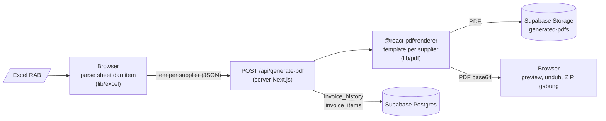

<!-- markdownlint-disable MD013 MD033 MD041 -->

<div align="center">

<picture>
  <source media="(prefers-color-scheme: dark)" srcset="docs/brand/logo-symbol-reversed.svg" />
  
</picture>

# Invoice Generator

**Satu file RAB, semua tagihan supplier beres.**

Unggah Excel RAB dapur SPPG, lalu aplikasi memecahnya per supplier<br />
dan membuat tagihan PDF resmi lengkap dengan rekening, tanda tangan, dan nomor urut.

### [Masuk di invoice-generate-v1.vercel.app](https://invoice-generate-v1.vercel.app)

[](https://github.com/shelviapramodita/invoice-generate/actions/workflows/ci.yml)
[](https://nextjs.org)
[](https://react.dev)
[](https://supabase.com)
[](https://tailwindcss.com)

</div>

> [!NOTE]
> Aplikasi internal untuk operator dapur SPPG. Pengguna perlu akun dengan langganan aktif yang disetujui admin.
> Vercel men-deploy `main` ke produksi. Data, akun, dan PDF disimpan di Supabase.

## Kenapa Invoice Generator

Setiap hari dapur SPPG menerima RAB dalam satu workbook Excel: satu sheet per hari, berisi belanja dari beberapa supplier sekaligus. Membuat tagihan per supplier secara manual berarti menyalin baris, menghitung ulang total, memasang rekening dan tanda tangan yang benar, lalu menomori dokumennya satu per satu. Invoice Generator mengerjakan semua itu dari file RAB yang sama. Supplier yang tidak dikenali dilaporkan, tidak pernah diam-diam dibuatkan tagihan atas nama pihak lain.

## Fitur

- **Excel multi-sheet.** Setiap sheet dibaca sebagai satu hari. Tanggal, rentang tanggal, kategori (OPS, OPS GALON), dan tahap pengiriman dikenali dari nama sheet seperti `21 JAN 2026 DONE`, lalu kamu memilih hari mana saja yang dibuatkan tagihan.
- **Deteksi supplier.** Supplier dikenali dari kolom SUPPLIER, nama pemilik rekening, atau nomor rekening, termasuk nama lama setelah rebrand. Nama item dirapikan otomatis (huruf, satuan, isi kemasan).
- **Tagihan PDF per supplier.** Lima template resmi (PT Jayamen Group Mandiri, UMKM Undi Yuwono, Nusantara Food, Sri Karya Mukti, UD Hidayat) dengan varian TAGIHAN atau KWITANSI. Invoice lama tetap memakai format FAKTUR sesuai tanggalnya.
- **Pengaturan per hari.** Tanggal invoice, nama batch, nomor awal yang berlanjut antarhari, dan "Tagihan Kepada" per supplier.
- **Preview dan unduh.** Preview layar penuh, lalu unduh satu per satu, sebagai ZIP per batch, atau digabung jadi satu PDF.
- **Riwayat.** Setiap batch tersimpan. Item bisa diedit, ditambah, atau dihapus, lalu PDF-nya dibuat ulang otomatis. Batch bisa dihapus satuan atau sekaligus.
- **Akun dan langganan.** Daftar akun, unggah bukti transfer, persetujuan admin, hitung mundur masa langganan, suspend dan ban dengan jalur banding, satu sesi aktif per akun, dan riwayat login.

## Cara pakai

1. Masuk, lalu buka **Upload Excel Baru** dan pilih workbook RAB.
2. Centang sheet (hari) yang mau dibuatkan tagihan.
3. Di **Pengaturan Invoice per Hari**, cek tanggal, nama batch, nomor invoice awal, dan "Tagihan Kepada". Nama SPPG terisi otomatis dari nama file, misalnya `RAB SPPG Tambak.xlsx` jadi `Tambak`.
4. Generate, lalu periksa hasilnya di **Preview Invoice PDF**. Ganti varian TAGIHAN/KWITANSI kalau perlu.
5. Unduh PDF-nya, atau buka lagi kapan saja dari **History Invoice** untuk mengedit dan mengunduh ulang.

## Cara kerja



- **Excel dibaca di browser.** File RAB tidak pernah diunggah. Server hanya menerima item yang sudah dikelompokkan per supplier.
- **PDF dibuat di server.** `@react-pdf/renderer` dan semua template hanya jalan di server. Browser cuma memuat helper unduh yang ringan.
- **Satu peta supplier ke template.** `renderSupplierTemplate` dipakai saat generate pertama dan saat PDF dibuat ulang dari riwayat, jadi hasil keduanya selalu sama.
- **Hemat storage.** Logo, tanda tangan, dan cap disimpan di 300 dpi dari ukuran tampilnya, jadi satu PDF rata-rata sekitar 100 KB.

## Mulai lokal

Butuh Node.js 20.9 atau lebih baru dan project Supabase.

```sh
git clone https://github.com/shelviapramodita/invoice-generate.git
cd invoice-generate
npm install                  # sekalian mengaktifkan hook git
cp .env.example .env.local   # isi URL dan key Supabase
npm run dev                  # http://localhost:3000
```

| Perintah | Fungsi |
| --- | --- |
| `npm run dev` | Server development (Turbopack) |
| `npm run build` | Build production |
| `npm run typecheck` | Cek tipe TypeScript |
| `npm run lint` | ESLint |
| `scripts/test-check-no-ai.sh` | Uji pola cek atribusi AI |

## Struktur

```text
invoice-generate/
├── app/                   # halaman (upload, history, admin, auth) dan route API
├── components/            # komponen UI: excel, invoice, history, auth, ui (shadcn)
├── lib/
│   ├── excel/             # parser workbook dan normalisasi nama item
│   ├── pdf/               # generator, template per supplier, varian dokumen, helper unduh
│   ├── db/                # query Supabase untuk riwayat invoice
│   ├── storage/           # unduh PDF dari Storage
│   └── supabase/          # client browser, server, dan middleware
├── data/                  # data resmi supplier: rekening, alamat, warna
├── types/                 # tipe bersama
├── public/assets/         # logo, tanda tangan, dan cap supplier untuk PDF
├── supabase/migrations/   # perubahan skema dan policy yang sudah diterapkan
├── scripts/               # cek atribusi AI
├── docs/brand/            # logo, ikon, dan panduan pemakaiannya
└── CLAUDE.md              # panduan arsitektur dan aturan kerja
```

## Gerbang mutu

GitHub Actions jalan di setiap PR dan setiap push ke `main`:

| Workflow | Isi |
| --- | --- |
| **CI** | `npm ci`, typecheck, dan build production. |
| **No AI attribution** | Menolak atribusi AI di author, committer, pesan commit, serta judul dan deskripsi PR. Juga dicek hook `commit-msg` dan `pre-push`. |

ESLint belum masuk gerbang karena masih ada error `no-explicit-any` lama. Perubahan baru jangan menambah error.

## Keamanan dan privasi

- **Akses halaman di satu tempat.** `middleware.ts` mengarahkan pengguna yang belum masuk, yang diblokir, dan yang belum berlangganan. Halaman `/admin` hanya untuk role admin dari tabel `profiles`.
- **Setiap route API memeriksa sendiri.** Middleware tidak menyentuh `/api/*`, jadi setiap route memanggil `supabase.auth.getUser()` dan mengecek role bila perlu.
- **Storage tertutup.** Semua bucket private dan hanya bisa diakses pengguna yang masuk. Bukti transfer hanya bisa dibaca pemiliknya dan admin. Policy-nya tercatat di [`supabase/migrations/`](supabase/migrations).
- **Service role hanya di server.** Key ini hanya dipakai route admin untuk reset password dan tidak pernah dikirim ke browser.
- **Satu sesi aktif.** Login di perangkat lain menutup sesi lama, dan sesi yang lama diam otomatis keluar.

## Deploy

| Bagian | Di mana | Catatan |
| --- | --- | --- |
| Aplikasi | Vercel | `main` otomatis ke produksi. Env: `NEXT_PUBLIC_SUPABASE_URL`, `NEXT_PUBLIC_SUPABASE_ANON_KEY`, `SUPABASE_SERVICE_ROLE_KEY` |
| Database, Auth, Storage | Supabase (Free) | Kuota storage 1 GB, dan setiap PDF yang dibuat ikut tersimpan. Migrasi dijalankan lewat SQL Editor, lalu dicatat di `supabase/migrations/` |

## Berkontribusi

Alur kerja dan aturan lengkapnya ada di [`CLAUDE.md`](CLAUDE.md). Ringkasnya:

1. Sinkron dulu (`git switch main && git pull`), lalu pastikan `git config core.hooksPath` mengeluarkan `.githooks`.
2. Buat branch `feat/…`, `fix/…`, `chore/…`, atau `docs/…`, satu topik per PR.
3. Commit memakai Conventional Commits dalam Bahasa Indonesia, atas nama kamu sendiri dan tanpa atribusi AI.
4. Merge setelah CI dan cek `no-ai-attribution` hijau.

## Tim

<table>
  <tr>
    <td align="center"><a href="https://github.com/shelviapramodita"><br /><b>Shelvia Pramodita</b></a><br /><sub>Parser Excel, template PDF, data supplier</sub></td>
    <td align="center"><a href="https://github.com/HaikalFaruq"><br /><b>Muhammad Haikal Faruq</b></a><br /><sub>Akun, langganan, admin, riwayat</sub></td>
  </tr>
</table>

Logo, tanda tangan, cap, dan data rekening di `public/assets/` dan `data/` milik masing-masing supplier dan hanya dipakai untuk tagihan mereka.
