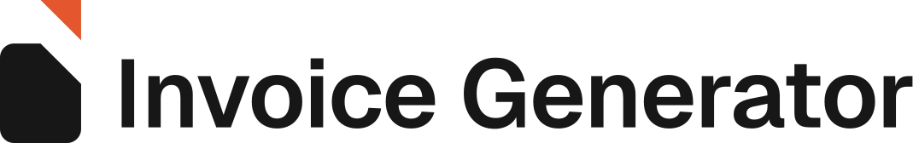

<!-- markdownlint-disable MD033 MD041 -->

  <picture>
    <source media="(prefers-color-scheme: dark)" srcset="logo-horizontal-reversed.svg" />
    
  </picture>

# Panduan logo

## Idenya

Huruf **i** dari *invoice*. Titiknya adalah sudut kertas yang terlipat: potongan dari sudut kanan atas lembar tagihan, diangkat ke atas. Logonya cuma dua bentuk, jadi tetap jelas sampai ukuran favicon 16 px.

## Versi dan file

Semua master berupa SVG di folder ini. Teks wordmark sudah diubah jadi path, jadi tidak bergantung pada font yang terpasang.

| Versi | Latar terang | Latar gelap | Satu warna |
| --- | --- | --- | --- |
| Horizontal (utama) | [`logo-horizontal.svg`](logo-horizontal.svg) | [`logo-horizontal-reversed.svg`](logo-horizontal-reversed.svg) | [`-black`](logo-horizontal-black.svg) · [`-white`](logo-horizontal-white.svg) |
| Bertumpuk | [`logo-stacked.svg`](logo-stacked.svg) | [`logo-stacked-reversed.svg`](logo-stacked-reversed.svg) | |
| Simbol | [`logo-symbol.svg`](logo-symbol.svg) | [`logo-symbol-reversed.svg`](logo-symbol-reversed.svg) | [`-black`](logo-symbol-black.svg) · [`-white`](logo-symbol-white.svg) |
| Wordmark | [`logo-wordmark.svg`](logo-wordmark.svg) | [`logo-wordmark-white.svg`](logo-wordmark-white.svg) | |
| Ikon aplikasi | [`app-icon.svg`](app-icon.svg) | | |

Ikon yang dipakai aplikasi ada di `app/`, mengikuti konvensi file Next.js:

| File | Isi |
| --- | --- |
| `app/icon.svg` | Favicon utama: tile tinta, simbol putih dengan titik jingga |
| `app/favicon.ico` | Cadangan untuk browser lama (16, 32, 48 px) |
| `app/apple-icon.png` | Ikon layar utama iOS, 180 px, tanpa sudut membulat (iOS membulatkan sendiri) |

Versi putih (`-reversed` dan `-white`) sedikit lebih tipis dari versi gelap. Bentuk putih di latar gelap terlihat lebih tebal, jadi penipisan ini membuat keduanya tampak sama berat. Jangan ganti versi putih dengan sekadar mewarnai ulang versi gelap.

## Warna

| Nama | HEX | RGB | CMYK (perkiraan) | Pantone (perkiraan) | Dipakai untuk |
| --- | --- | --- | --- | --- | --- |
| **Tinta** | `#171717` | 23 23 23 | 0 0 0 91 | Neutral Black C | Badan simbol, wordmark, tile ikon. Sama dengan `--primary` di UI aplikasi. |
| **Jingga** | `#E4572E` | 228 87 46 | 0 72 85 0 | 7417 C | Titik di atas simbol, dan hanya di situ. |
| Putih | `#FFFFFF` | 255 255 255 | 0 0 0 0 | | Versi untuk latar gelap |

Jingga adalah aksen, bukan warna latar utama. Di layout, pakai sedikit saja. Kontrasnya 3,7 : 1 terhadap putih dan 5,1 : 1 terhadap latar gelap GitHub. Angka CMYK dan Pantone hanya perkiraan, jadi cek dulu ke proof cetak sebelum mencetak.

**Pasangan yang boleh dipakai**

- Warna penuh di latar putih atau terang.
- `-reversed` di latar tinta atau gelap.
- `-white` di latar jingga atau foto yang tenang.
- `-black` untuk cetak satu warna.

## Ruang kosong

Satuan **x** adalah panjang sisi tegak segitiga titik, sekitar 28 % tinggi simbol. Sisakan minimal **1 x** di setiap sisi logo. Jarak antara simbol dan wordmark di lockup juga 1 x, jadi jangan diubah.

## Ukuran minimum

| Versi | Layar | Cetak |
| --- | --- | --- |
| Horizontal | lebar 140 px | lebar 35 mm |
| Bertumpuk | lebar 120 px | lebar 30 mm |
| Simbol | tinggi 16 px | tinggi 6 mm |

## Tipografi

Wordmark memakai **Geist SemiBold (600)**, font yang sama dengan UI aplikasi (`next/font/google`), dengan tracking −1 %. Versi putihnya memakai berat 580. Lisensi Geist adalah SIL Open Font License 1.1. Kalau butuh logo, pakai file SVG-nya. Jangan mengetik ulang "Invoice Generator" dengan font apa pun.

## Konstruksi simbol

Di kanvas 256 × 256, badan halaman berukuran 124,8 × 153,6 dengan radius sudut 21,6. Lipatan di sudut kanan atas memotong 62,4, yaitu setengah lebar badan. Titiknya adalah potongan itu, diangkat 67,2 ke atas dengan sisi kanan tetap sejajar badan. Di lockup horizontal, tinggi simbol 2,1 × tinggi huruf kapital, dan tengah badan halaman sejajar dengan tengah huruf kapital.

## Jangan

- Meregangkan, memiringkan, atau memutar logo.
- Mengganti warna di luar palet. Warna lain untuk titik, gradien, bayangan, dan outline juga tidak boleh.
- Memindah atau mengubah ukuran titik terhadap badan halaman, atau mengubah jarak simbol dan wordmark.
- Menaruh versi warna penuh di latar ramai tanpa tile.
- Memakai simbol tanpa tile di bawah 16 px.
